<h1 align="center">
  
</h1>

  <b>Building scalable systems, high-performance web applications, and autonomous AI agents.</b>

  
  
  
  

---

## 👨‍💻 Animated Profile & System Info

  <table>
    <tr>
      <td align="center" valign="top" width="50%">
        <h3>🎨 Animated ASCII Portrait</h3>
        
      </td>
      <td align="center" valign="top" width="50%">
        <h3>💻 Neofetch Terminal Info</h3>
        
      </td>
    </tr>
  </table>

---

## 📊 Live Contribution Heatmap & Streaks

  

---

## 🚀 Tech Stack & Tooling

  

---

## ⚙️ How It Works (Zero-JavaScript SVG Architecture)

This profile README uses pure **SMIL (Synchronized Multimedia Integration Language)** embedded inside standard SVG files.

1. **`avi-ascii.svg`**: Python converts profile images into ASCII character grids and renders SMIL `<animate>` tags for typing reveals and blinking terminal cursors.
2. **`info-card.svg`**: Neofetch-style system metrics animated line-by-line using pure vector keyframes.
3. **`contrib-heatmap.svg`**: Scraped contribution data formatted into GitHub dark mode grid squares with top statistics cards.
4. **GitHub Actions (`update-profile-art.yml`)**: Cron workflow automatically updates contribution metrics and SVGs every midnight.

---

  Built with ❤️ using Python, Pure SVGs, and GitHub Actions Automation.

